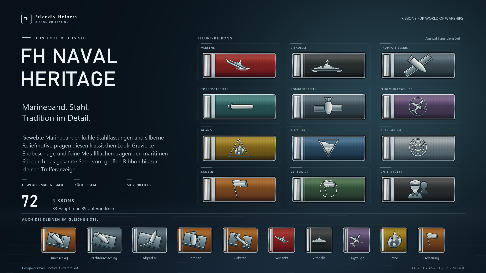
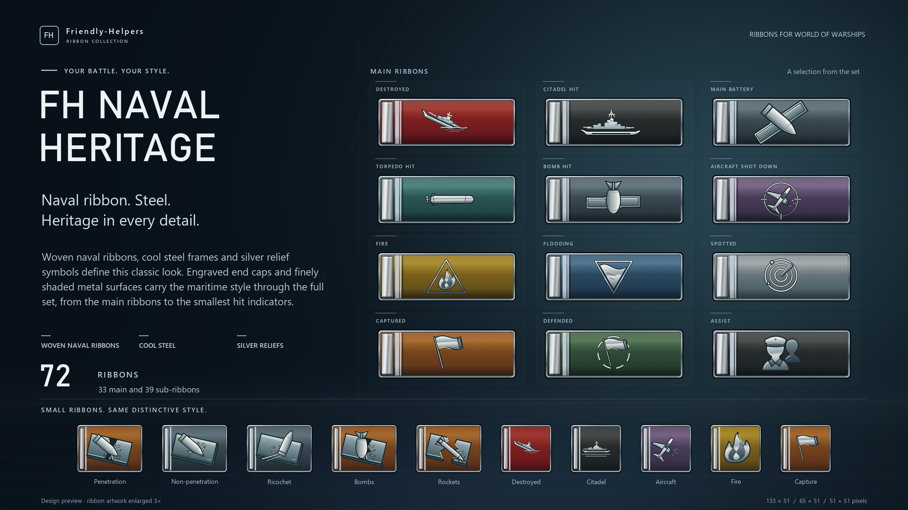

# FH Naval Heritage

**Friendly-Helpers · Ribbon Collection**

Designvorschau für World of Warships · Design showcase for World of Warships

## Deutsch

Gewebte Marinebänder, kühle Stahlfassungen und silberne Reliefmotive prägen diesen klassischen Look. Gravierte Endbeschläge und feine Metallflächen tragen den maritimen Stil durch das gesamte Set – vom großen Ribbon bis zur kleinen Trefferanzeige.

Das Set umfasst **72 Grafiken**: 33 Haupt-Ribbons, 25 rechteckige und 14 quadratische Untergrafiken.

Die Vorschau zeigt zwölf Haupt-Ribbons und zehn Untergrafiken, jeweils 3× vergrößert.

## English

Woven naval ribbons, cool steel frames and silver relief symbols define this classic look. Engraved end caps and finely shaded metal surfaces carry the maritime style through the full set, from the main ribbons to the smallest hit indicators.

The set contains **72 graphics**: 33 main ribbons, 25 rectangular sub-ribbons and 14 square sub-ribbons.

The preview shows twelve main ribbons and ten sub-ribbons, each enlarged 3×.

